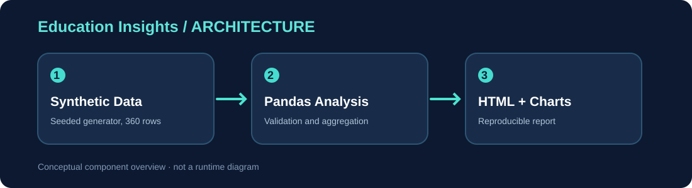
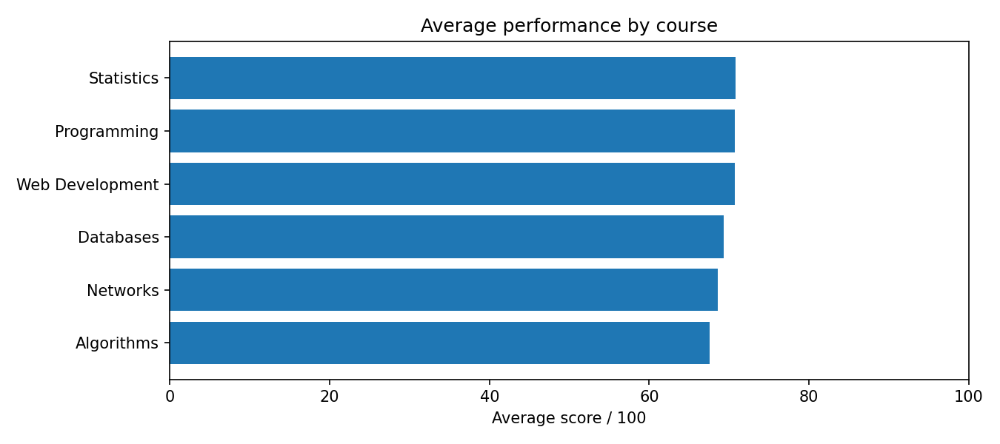
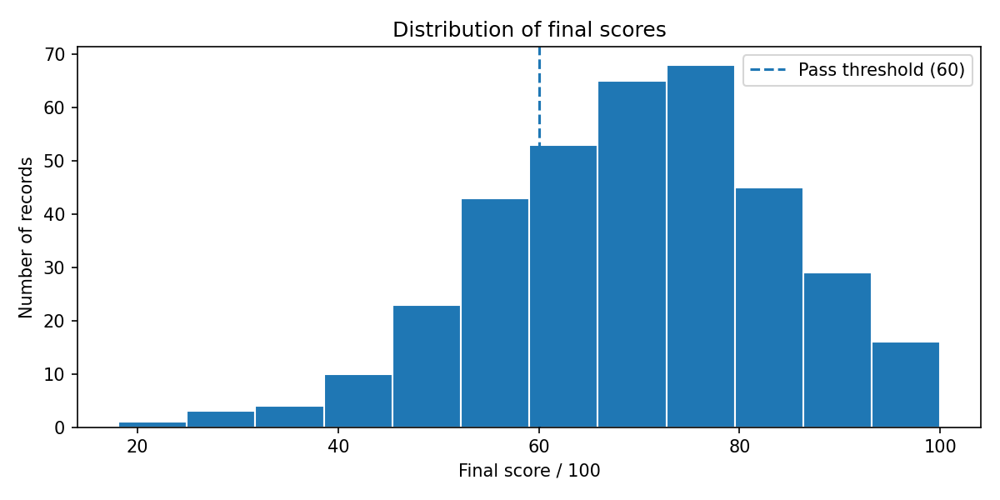
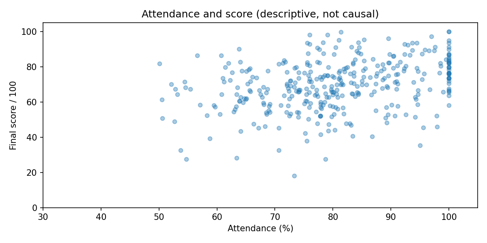
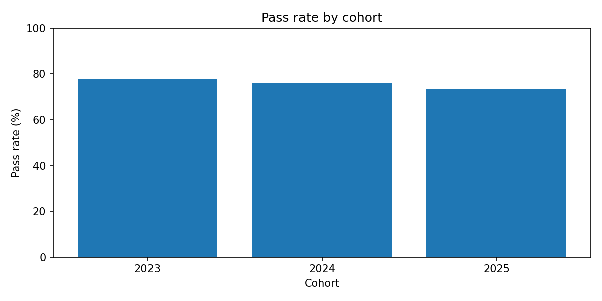

<p align="center"></p>
<p align="center"><strong>Reproducible learning analytics</strong></p>
<p align="center"><code>Python · pandas · matplotlib</code></p>

> **Portfolio learning project / AI-assisted starter.** This project demonstrates skills under development; tests and deployment limits are disclosed below. All examples are fictional.

**Project tour:** [Architecture](#architecture-at-a-glance) · [Run locally](#quick-start) · [Testing and limitations](#verification-status)

## Architecture at a glance



## Verification status

Python unit tests passed; local HTML dashboard generated. These checks do not certify the app as production-ready.

# Education Insights — Python Data Analysis


A reproducible data-analysis portfolio project using **Python, pandas and matplotlib**. Generates a responsive HTML dashboard, summary CSVs and 4 publication-ready charts from **synthetic** education records (never real students' personal information).

## Quick start

```bash
python -m venv .venv
# Linux/macOS: source .venv/bin/activate
# Windows: .venv\Scripts\activate
pip install -r requirements.txt
python -m education_insights --generate
```

Open `reports/index.html` in a browser. No website hosting or internet connection is required after installing dependencies. The repository includes a generated sample report at `reports/index.html` for immediate preview. A copy is available in `docs/` for free GitHub Pages publishing (Settings → Pages → Deploy from branch → `main` / `docs`).

## What the analysis includes

- Input validation and duplicate-record detection
- Per-course average scores and pass rates
- Score distribution and cohort comparisons
- Attendance vs. score visualization (correlation is **not** causation)
- CSV exports for reproducibility
- Deterministic fictional dataset (360 records, seed 42)

## Re-run the tests

```bash
pip install pytest
pytest -q
```

## Implementation notes

- Scores are fictional. They are generated from a transparent pseudorandom model and **must not** be presented as real admissions research.
- `final_score = 0.30 * assignment_pct + 0.70 * exam_pct`; passing is defined as `final_score >= 60` by default.
- Customize: `python -m education_insights --generate --count 500 --seed 7 --pass-mark 65`.
- Skills: data cleaning, descriptive statistics, visualization, CLI design, testing, and clear communication of limitations.

## Gallery

<p align="center"> </p>
<p align="center"> </p>

These four graphics were generated from the project's synthetic dataset using Python, pandas and matplotlib. They are real analysis outputs, not mockups.

## License

MIT; see `LICENSE`.

## Portfolio attribution / next steps

This project began as an **AI-assisted portfolio starter**. Before adding it to an academic application, review the code, run the app, make improvements you understand, and describe your actual role accurately. Do not present generated code as entirely hand-written or portray fictional demonstration data as real records.
